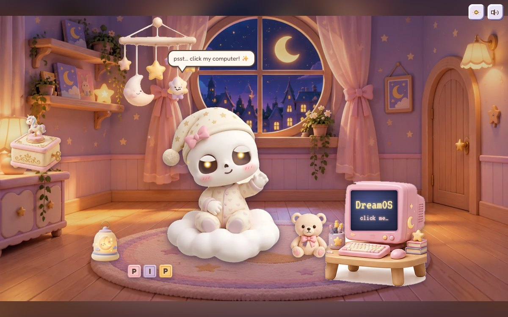
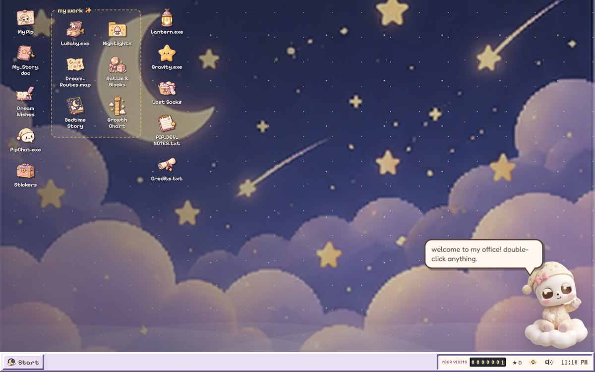
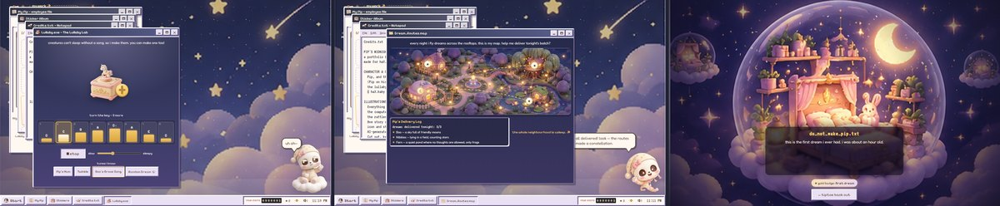
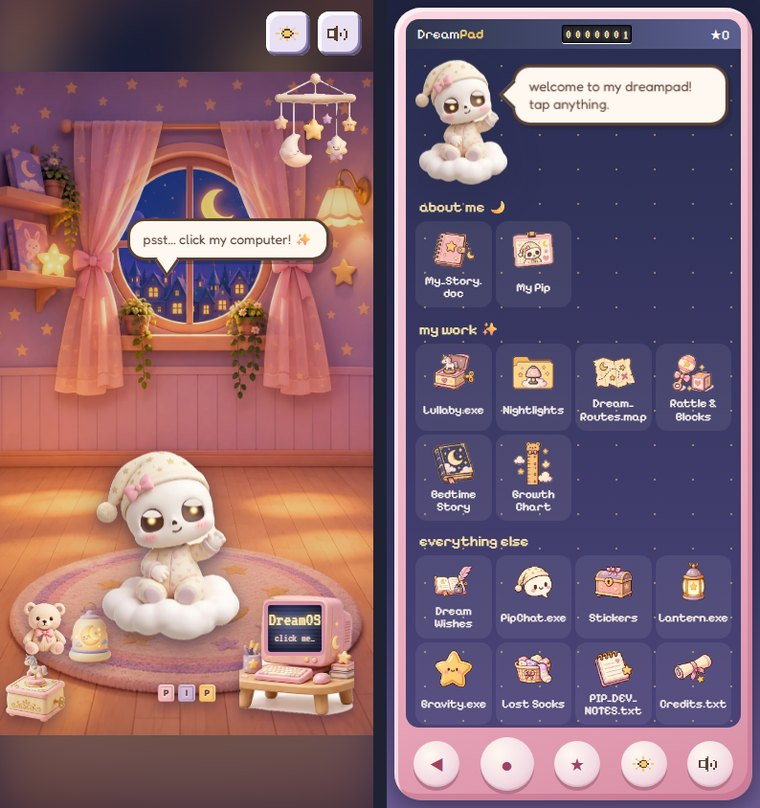
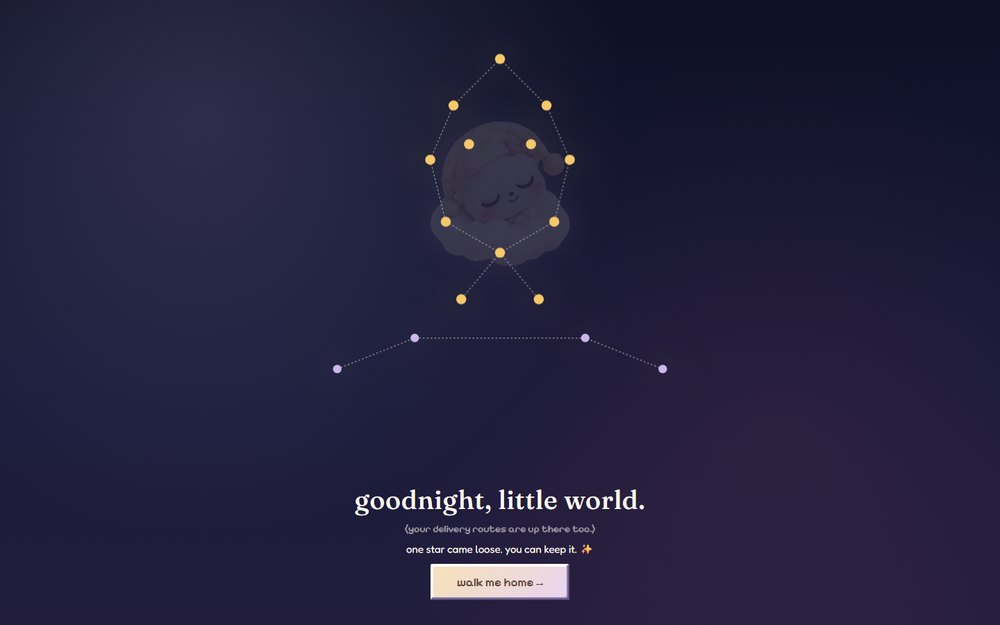

<div align="center">

# 🌒 Pip's Midnight Nursery

**A tiny skull baby with a very important job: Junior Dream Engineer.**

[**Visit the nursery →**](https://pipnursery.vercel.app/)

</div>



Welcome to Pip's little corner of the internet, where bedtime comes with its own
operating system, lullabies have their own programs, and even the nightlights
have a personality. 🪔 Boot up DreamOS 98, poke around the nursery, deliver a few
dreams, and see what happens when a curious little skull baby gets his hands on a
computer.

There's music to make 🎼, toys to play with 🪇, a bedtime story to uncover 📖, and
wishes waiting to be left behind. If you're the sort who clicks on absolutely
everything, you're in luck. Pip has a few secrets tucked away for visitors who
refuse to go to bed on time. 🗝️

Built as a playful, interactive portfolio, Pip's Midnight Nursery brings together
a nostalgic desktop experience, small interactive projects, character-driven
storytelling, and a handful of surprises. It's part portfolio, part nursery, and
part very tiny dream factory. 🧸

> Made for **haX.baby · Baby's First Website**, Track 1.

---

## How it works

You land in Pip's room at night. He notices you, and his eyes follow you around.
On the desk there's a chunky pastel CRT — click it, and the camera **zooms into
the screen itself**, DreamOS 98 boots, and you're inside Pip's actual workspace.



The best part is that the two worlds leak into each other. **Finishing something
changes the nursery.** Compose a lullaby and the hanging mobile sways faster.
Light all three nightlights and the room glows warmer. Deliver the dreams and
the little rooftop windows light up through the glass. Read Pip's story to the
end and you come back to find him **asleep under a starry ceiling**, with the
book he wrote glowing on the shelf.

Nothing announces itself. The room has just quietly changed.



---

## What's inside

### Pip's six projects

| | |
|---|---|
| 🎼 **Lullaby.exe** | An 8-step pentatonic sequencer, scheduled against the AudioContext clock so a slow lullaby never drifts. Wind the key three times and the melody rises into two orbiting star rings. |
| 🪔 **Nightlights** | Three lamps, one per creature's particular fear. Cloudberry breathes on a six-second loop; Starling throws stars on the wall. A fourth is hidden in the order you light them. |
| 🌙 **Dream Routes** | Deliver tonight's dreams across a painted rooftop map. The routes draw themselves and Pip flies along them, sampled from the SVG path every frame. |
| 🪇 **Rattle & Blocks** | Rattles you can tap, drag, or shake your phone at. Six blocks that spell two things. Plus three small games. |
| 📖 **Bedtime Story** | *Boo and the Borrowed Moon* — a hardcover that opens, with six crayon pages that turn in 3D. |
| 📏 **Growth Chart** | A tall wall you scroll up, with pencil marks that draw themselves in as they arrive. |

### And everywhere else

- 📜 **My_Story.doc** — five scroll-snapped chapters. In chapter four, Pip's flight path across the rooftops is **drawn by your scrolling**. It ends in a finale where he becomes a constellation.
- 💬 **PipChat.exe** — a rule-based Pip who remembers your name, sings four real bars, tells Boo's story, and gives you one cryptic hint at a time.
- ✉️ **Dream Wishes** — a 2000s guestbook. Works with no backend at all, and says so honestly.
- ⭐ **Gravity.exe**, **Lantern.exe**, a sticker album, lost socks, and Pip's private dev notes.
- 🗝️ **Sixteen easter eggs** and **26 stickers** to collect.

---

## It's built for small screens too

Phones get a different retro skin entirely: **DreamPad**, a pastel handheld, with
its own painted portrait nursery. Tablets get maximised windows. Crossing a
breakpoint while the page is open makes Pip say *"whoa, the room is moving!"*



---

## Running it

You'll need [Node.js](https://nodejs.org/) and npm.

```bash
git clone https://github.com/nayanikakhote/pipnursery.git
cd pipnursery
npm install
npm run dev
```

Then open the local URL your terminal prints.

```bash
npm run build      # production build into dist/
npm run preview    # serve that build locally
npm run lint       # oxlint, plus a CSS class-collision check
```

### Testing it

```bash
npx playwright@1.64.1 install chromium   # once
npm run build && node tools/check.mjs
```

`tools/check.mjs` drives the whole site at **six viewports** — 1440×900,
1024×768, 820×1180, 390×844, 844×390 and 620×380 — opening and poking every
app. It fails the run on any console error, page error, failed request,
horizontal overflow, touch target under 44px, or text below WCAG AA contrast,
and drops screenshots in `tools/shots/` to look at.

It has caught several real bugs, including a CSS class collision that was laying
an entire app out 640px above its own window, and tab labels rendering
cream-on-white at 1.08:1 because a stylesheet hadn't loaded.

### Rebuilding the art

All the illustrations arrived as collage sheets, so the whole pipeline is
reproducible from two committed files:

```bash
pip install Pillow numpy scipy rembg
python tools/process_art.py --rembg --force --contact
```

`tools/crops.json` holds every piece's box and mode; `tools/process_art.py`
crops, cuts out, slices and resizes, then writes `src/content/art.gen.ts` — which
only ever lists files that really exist, so anything missing falls back to a
hand-built CSS version and the site still works. `--contact` renders every
cut-out on navy *and* on white, because a halo invisible against one background
is obvious against the other.

```bash
python tools/make_favicons.py       # every icon size, from one drawing
python tools/make_og.py             # the social card
python tools/make_readme_shots.py   # the images in this file
```

---

## Project structure

```
src/
  scenes/      nursery · boot · DreamOS desktop · DreamPad · finale · secret room
  os/          the window manager, app registry, desktop toys
  apps/        one folder per app, each with its own stylesheet
  components/  Pip himself, icons, controls, the sparkle trail
  audio/       the whole sound engine — synthesized, no audio files
  content/     every line Pip says, the sticker list, the art registry
  store/       one typed Zustand store, persisted
tools/         the QA harness and the art pipeline
```

Each app is code-split and lazily loaded, then **prefetched during idle time**
once the desktop appears, so clicking an icon doesn't wait on a network round
trip.

---

## Easter eggs

<details>
<summary><b>Spoilers — sixteen things to find</b></summary>

1. **Boop Pip five times** in his room.
2. **Five tiny stars** hidden on the painted nursery wall.
3. **Squeeze the teddy** three times.
4. **↑ ↑ ↓ ↓ ← → ← → B A**, or tap the taskbar clock seven times.
5. **Read Pip's private dev notes.**
6. **Shut Down** from the Start menu, then wake him.
7. **Light the nightlights** Moonbeam → Cloudberry → Starling for a fourth lamp.
8. **Play a whole lullaby, then** light them Moonbeam → Starling → Cloudberry for Pip's Secret Song.
9. **Spell PIP** with the blocks. (ZZZ does something else.)
10. **Open four windows at once.**
11. **Lantern.exe** — five stars and three notes hide on the wallpaper in the dark.
12. **Gravity.exe.**
13. **do_not_wake_pip.txt**, which only appears once you've found egg 1.
14. **Finish the story** — the star that comes loose is yours to keep.
15. **Say something to Pip** in PipChat.
16. **Leave a wish** in the guestbook.

…and a bonus with no sticker attached: **open the DevTools console.**

Collect all 26 stickers and the nursery gets a **100% DREAMY** banner.

A full shot-by-shot route through every one of these lives in
[`DEMO_WALKTHROUGH.md`](DEMO_WALKTHROUGH.md).

</details>

---

## Optional: a shared guestbook and a real hit counter

The site is complete without this. In local mode the guestbook saves to your own
browser and says so in as many words, and the odometer counts *your* visits,
labelled "YOUR VISITS". **A local wall is never described as live or shared.**

To make it shared:

1. Create a project at [supabase.com](https://supabase.com) — the free tier is plenty.
2. Open **SQL Editor** and run all of [`supabase/schema.sql`](supabase/schema.sql).
3. In **Project Settings → API**, copy the *Project URL* and the *anon public* key.
4. Add them to your host as `VITE_SUPABASE_URL` and `VITE_SUPABASE_ANON_KEY`.
5. Redeploy. The guestbook becomes shared and the odometer switches to "VISITORS"
   on its own — no code change.

The counter starts at **0**, not at a seeded number, so what it shows is true.

---

## A note on craft

- **Every sound is synthesized live** with the Web Audio API. There is not a single audio file in this repository — the lullabies, the music box, the chimes and Pip's giggle are all oscillators.
- **Nothing plays before your first click**, everything routes through one master gain, and the mute switch silences all of it.
- **Mouse, touch and keyboard everywhere.** The blocks use tap-to-pick then tap-to-place rather than a drag, because that one interaction serves all three.
- **Every touch target is at least 44px.** The Win98 window buttons keep their small, correct look but push their hit area out with a pseudo-element.
- **Reduced motion has a calm fallback** for every animation, and the audio graph suspends when the tab is hidden.

---

## Credits

Created for **haX.baby: Baby's First Website**, Track 1.

- Pip and the official renders — Pip on his cloud, the ID-card portrait, the music box, the dream lantern — are **© haX.baby**, from the Track 1 creator asset pack.
- All other illustrations are **AI-generated with ChatGPT** for this project, then cut out and resized by `tools/process_art.py`.
- Every sound is synthesized live with the Web Audio API; there are no audio files in this repository.
- Fonts: **Fraunces**, **Fredoka**, **Pixelify Sans** and **VT323** (Google Fonts, SIL Open Font License).
- Built with React, TypeScript, Vite, Zustand, Framer Motion and canvas-confetti.

The full credits are also readable inside the site, in `Credits.txt` on Pip's
desktop.

---

<div align="center">



**Pip says it's bedtime. Pip is also still on his computer. 🌙**

</div>
